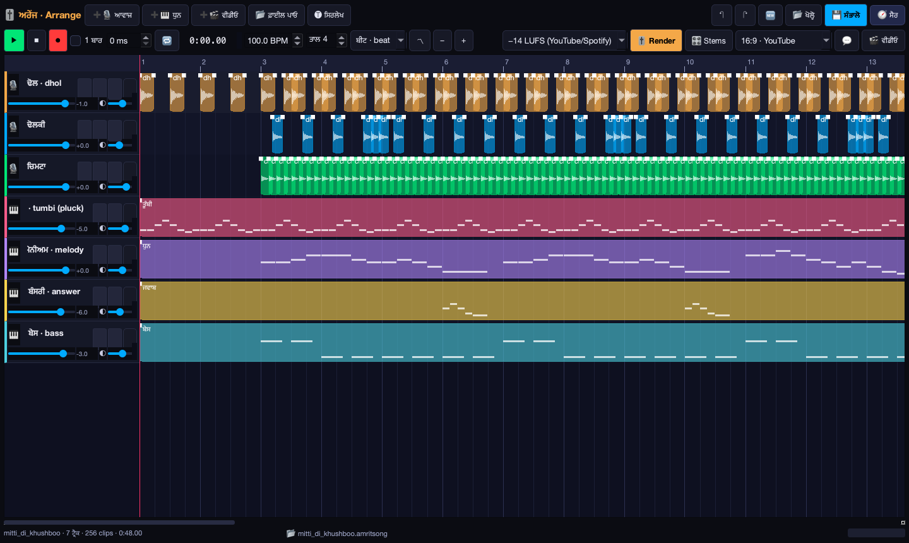
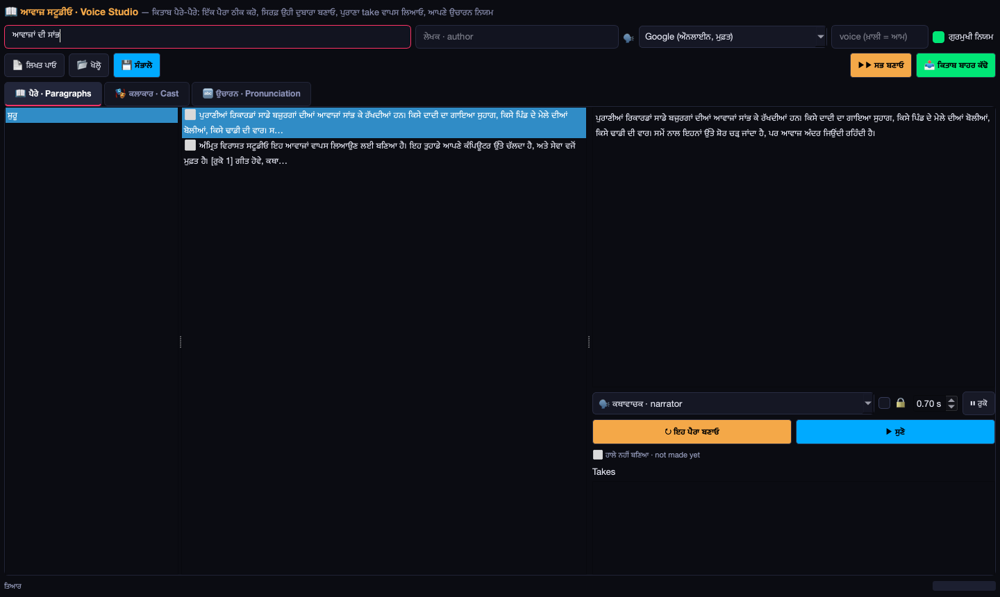

<h1 align="center">Amrit Virasat Studio</h1>

<b>A Punjabi-first desktop studio for old recordings, music and audiobooks. Free, as seva.</b> 
ਪੁਰਾਣੀਆਂ ਰਿਕਾਰਡਾਂ, ਸੰਗੀਤ ਅਤੇ ਆਡੀਓਬੁੱਕਾਂ ਲਈ ਪੰਜਾਬੀ desktop studio — ਸੇਵਾ ਵਜੋਂ ਮੁਫ਼ਤ।

<a href="https://github.com/gurpreetsingh5523-source/amrit-virasat-studio/releases/latest"><b>⬇ Download for Mac (Apple Silicon)</b></a> · <a href="https://sevabots.com/amrit-virasat.html">sevabots.com</a>

This repository holds the downloads, samples and help. The studio runs on your own computer.

## What it does

- **🎙 Voice Rescue** — pull the voice out of an old song or record, remove hum, clicks and hiss, and get it ready
  for YouTube, Spotify and WhatsApp. Every step is measured before and after.
- **📓 Notebook** — chat with your sources (PDFs, notes, YouTube links) in Punjabi. Answers cite the source, and
  a YouTube citation opens the video at that second. Needs an AI model: a free Gemini key or a local model.
- **📖 Voice Studio** — a book paragraph by paragraph: fix one paragraph, make it again, keep earlier takes, your
  own pronunciation rules, then export MP3 and M4B audiobooks.
- **🎚 Arrange** — tracks on a timeline with Punjabi instruments (dhol, dholki, chimta, tumbi, harmonium, bansuri).
- Also: stems, chords and key with sargam names, lyrics that follow the song, speech ↔ text, a video editor.

## Samples made with the studio

| Sample | What the studio did |
|---|---|
| [Mitti di Khushboo](samples/1-folk-geet-mitti-di-khushboo-made-in-studio.mp3) (48 s) | An original folk-style piece made entirely in 🎚 Arrange (screenshot above). The studio's own Chords tool reads it back as Sa = D, chords I ↔ IV. |
| Ghalib, *Dard minnat-kash-e-dawa na hua*: [original](samples/2a-ghazal-ghalib-original-librivox.mp3) → [studio](samples/2b-ghazal-ghalib-hum-removed-with-studio-tanpura.mp3) | 🎙 Voice Rescue removed the 50 Hz mains hum (21.3 dB → 0) and lowered the noise floor (−54.6 → −59.0 dB); a tanpura and harmonium drone made in Arrange, tuned to the reciter's Sa (A), sits underneath. |
| [ਆਵਾਜ਼ਾਂ ਦੀ ਸਾਂਭ](samples/3-voice-studio-audiobook-punjabi.mp3) (34 s) | 📖 Voice Studio read our own Punjabi text ([text](samples/3-voice-studio-text.txt)) with the Gemini voice, checked each paragraph and exported the audiobook. |

## Install (Mac)

1. Download `AmritVirasat-<version>-arm64.dmg` from [Releases](https://github.com/gurpreetsingh5523-source/amrit-virasat-studio/releases/latest).
2. Open it and drag **Amrit Virasat** to **Applications**.
3. Open it. The first time, macOS says it cannot check the app (it is not notarized by Apple yet): open
   **System Settings → Privacy & Security** and press **Open Anyway**.
4. **First launch only:** a setup window gets Python and the studio's libraries (about 1.4 GB, a few minutes,
   needs internet). After that the studio opens straight away.

**Needs:** a Mac with Apple Silicon (M1 or newer), macOS 12 or newer, about 3 GB of free disk.
Tested on a 16 GB Mac. The optional best voice separation (**📦 Install best AI**, another ~3 GB of disk) needs
4–5 GB of memory free while it works; close other big apps first.

Your files stay on your computer. Online parts are optional and only run when you choose them: Google and Gemini
voices, YouTube links, and AI models you connect yourself.

Windows and Linux: later.

## Licence

Free for noncommercial use: personal use, study, research, gurdwaras, schools, charities and other noncommercial
organisations ([PolyForm Noncommercial 1.0.0](LICENSE), see [NOTICE](NOTICE)). Companies and any commercial use
need written permission first. Open-source parts and their licences: [THIRD_PARTY_NOTICES.md](THIRD_PARTY_NOTICES.md).
The Mac app also carries [uv](https://github.com/astral-sh/uv) (MIT / Apache-2.0) to set up Python; on a Mac
without FFmpeg, setup downloads the [static-ffmpeg](https://pypi.org/project/static-ffmpeg/) builds.

**Sample credits:** Ghalib's ghazal is from the public-domain LibriVox recording *Selected Ghazals of Ghalib*
(read by Ahkam, via Wikimedia Commons). *Mitti di Khushboo*, the instrument sounds and the Punjabi text are our own.
The audiobook voice is Google Gemini text-to-speech.

## Contact and support

Questions, a broken sample, or an old family recording that will not clean up: **hello@sevabots.com**.
The studio is free. If it helps you, you can support it at [sevabots.com](https://sevabots.com/#donate).
